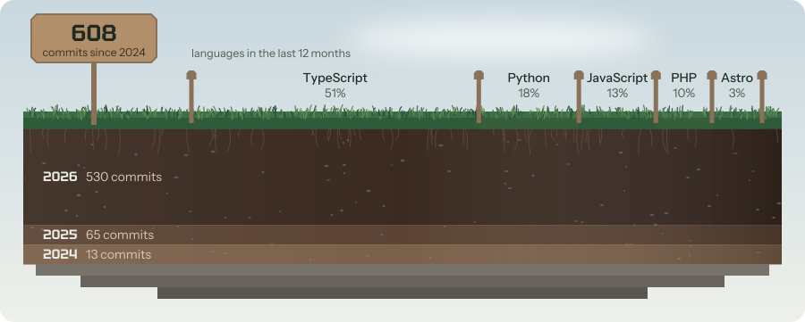

  <picture>
    <source media="(prefers-color-scheme: dark)" srcset="assets/hero-night.svg">
    
  </picture>

  <picture>
    <source media="(prefers-color-scheme: dark)" srcset="assets/field-night.svg">
    
  </picture>

## Featured Projects

| Project | What it is |
| --- | --- |
| [InternIQ](https://github.com/burakyalcin10/InternIQ) | AI-powered internship search and prep platform, layered with the OpenAI SDK, CrewAI, LangGraph and MCP. [Live demo](https://intern-iq-iota.vercel.app) |
| [career-asistant-agent](https://github.com/burakyalcin10/career-asistant-agent) | An agent that answers employers on my behalf, with LLM-as-a-judge scoring and auto-revision. FastAPI and Gemini. |
| [echo-chamber-ai](https://github.com/burakyalcin10/echo-chamber-ai) | Interactive AI artwork that maps covers of "Knockin' on Heaven's Door" as a 3D emotional galaxy. |
| [TazelenmeApp](https://github.com/burakyalcin10/TazelenmeApp) | Student, attendance (RFID/NFC) and reporting platform for Tazelenme University's 60+ learners. |
| [SarkiSozleriPlayer](https://github.com/burakyalcin10/SarkiSozleriPlayer) | A Python app that detects and synchronizes lyrics while MP3 files are playing. |
| [DMPROJECT](https://github.com/burakyalcin10/DMPROJECT) | Fibonacci and Catalan path work for discrete mathematics. |
| [portfolio-yalcinburak](https://github.com/burakyalcin10/portfolio-yalcinburak) | Personal portfolio site for projects and creative work. |

## Now Building

<!-- recent:start -->
| Project | Language | Last push |
| --- | --- | --- |
| [TazelenmeApp](https://github.com/burakyalcin10/TazelenmeApp) | TypeScript | 2026-10-19 |
| [obsidian-vault-skill](https://github.com/burakyalcin10/obsidian-vault-skill) | Python | 2026-09-25 |
| [InternIQ](https://github.com/burakyalcin10/InternIQ) | Python | 2026-05-07 |
<!-- recent:end -->

## Tech Stack

<!--
  Spotify setup:
  Connected with Spotify GitHub Profile.
-->

  

  

